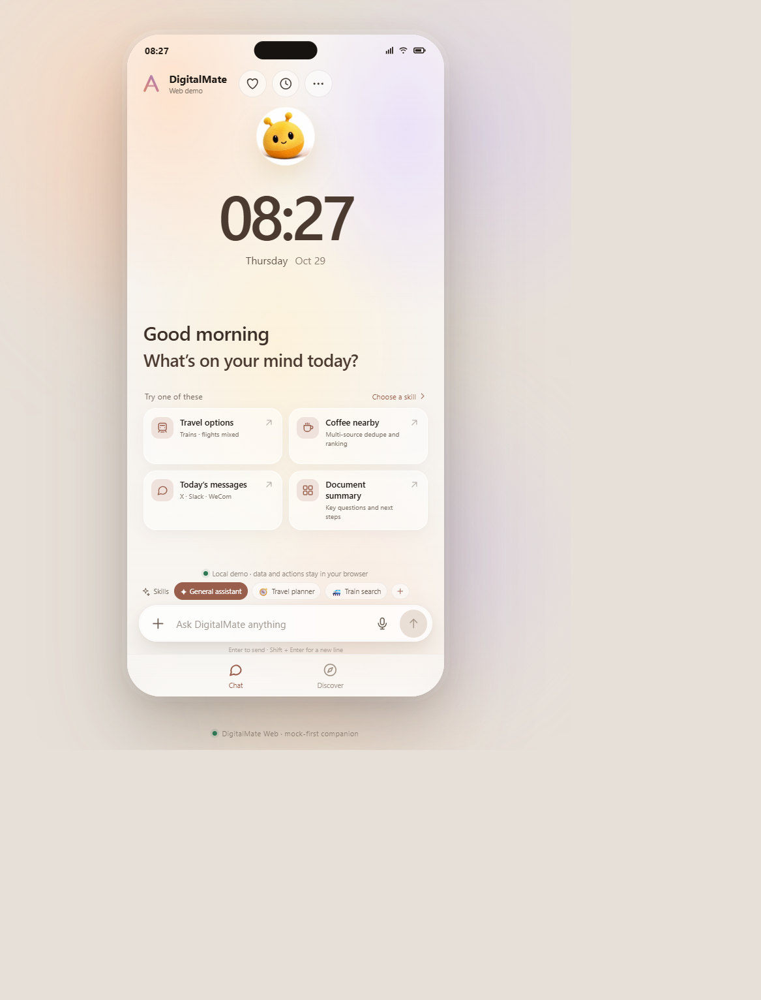
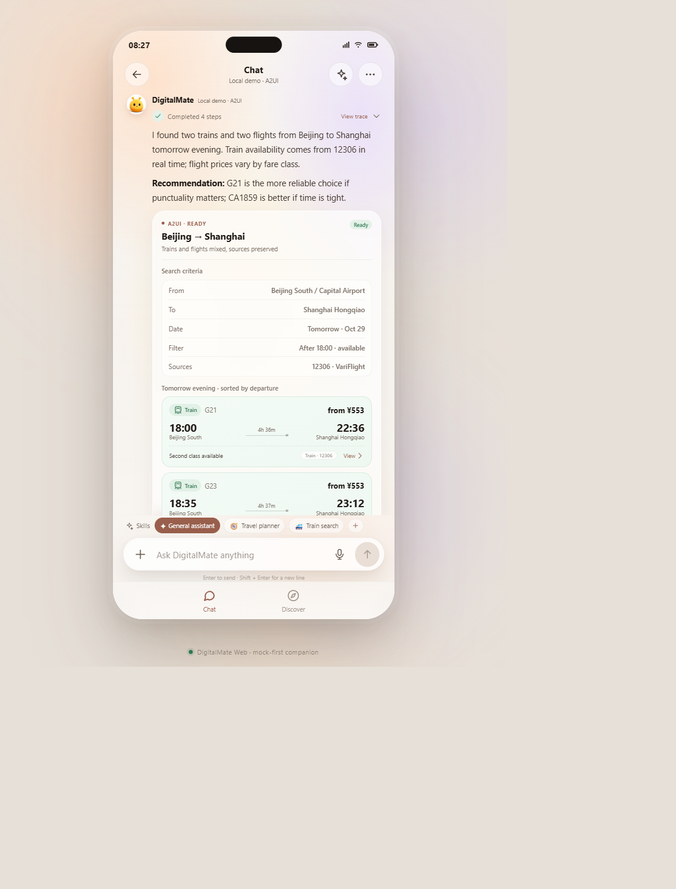
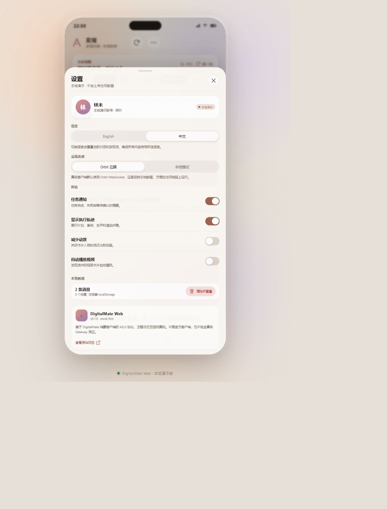

# DigitalMate Web

An independent, **bilingual (English / 简体中文)** web companion for the DigitalMate
HarmonyOS agent app. It starts as a mock-first prototype and is structured to grow into a
real Jiuwen/Orbit-connected client and, later, an Android app.

> **This repository contains only the new web implementation.** The original DigitalMate
> native app, its ArkTS modules, build system and test suites are not included.

**Live app (no account needed):** <https://michaelatamuk.github.io/digitalmate-web/>



| Chat | Chinese settings |
| --- | --- |
|  |  |

## Status

- Mock-first by default: local data, no account login required
- Full English and Simplified Chinese UI, switchable in **Settings → Language**
- BeeBou mascot on the home screen, assistant avatar, execution trace and about card
- Card detail sheets, local calendar event creation and a guided demo mode
- A2UI JSONL parser and surface store with a protocol-driven demo surface
- Transport layer with mock and Orbit implementations
- Optional Orbit bridge: server-side Bearer token, WSS upstream, SSE to the browser
- 84 unit tests plus 21 Playwright UI, mobile and accessibility checks
- Responsive phone UI that runs in Chrome
- `npm run build`, `npm test` and the GitHub Actions build are expected to pass

The remaining milestone is production authentication and deployment in front of a real
Jiuwen/Orbit gateway. See [docs/roadmap.md](docs/roadmap.md) and
[docs/architecture.md](docs/architecture.md).

## Features

| Area | Current behaviour |
| --- | --- |
| Home | Live clock, greeting, BeeBou welcome mascot, suggestions, continue-last-chat |
| Chat | Transport streaming, execution trace, markdown, follow-ups, copy/share/retry/clear |
| Artifacts | Save replies with A2UI surfaces, browse, preview, download and delete |
| Attachments | Local picker, text/image preview, PDF text extraction; nothing uploaded |
| Transport | Mock chat + local discovery transports; optional Orbit bridge |
| Orbit bridge | Delegated token, WSS/SSE stream, A2UI surfaces, retry and snapshots |
| Memory | Editable local profile with evidence notes; forget everything |
| Card details | Travel, train and food cards open a detail sheet with source and copy actions |
| A2UI | Declarative renderer for 34 components, 15 scenarios and a JSONL protocol demo |
| Discovery | Local search, topic/source filters, reactions, saved cards, share, RSS import |
| Skills | Detail view, install/toggle, local JSON import/export |
| Calendar | Local event creation with a confirmation sheet and updated schedule card |
| Hotel / ride / payment | Mock comparison cards with refundable tags, fare estimates and payment review |
| Media | Scene tabs and a media slider for podcasts and short video |
| Offline / PWA | Installable build, offline shell and update check with app version |
| Your data | Export/import a local JSON backup of chats, calendar, saved cards and settings |
| Guided demo | One-click scripted walkthrough of travel, calendar, food, discovery and memory |
| Settings | Language, backend preference, notifications, trace, reduced motion, reset |
| History | Archived conversations when starting a new chat |

Scenarios currently include travel, hotel, ride, payment review, media, daily brief, weekly insights, shopping, food/coffee, social,
mail, calendar, document summary, weather and generic tool results.

## Quick start

```bash
npm ci
npm run dev
```

Open <http://127.0.0.1:5173>.

Production build:

```bash
npm run build
npm run preview
```

Tests:

```bash
npm test        # unit tests
npm run test:e2e   # Playwright UI, mobile and axe checks
```

## Local RSS proxy

Discovery can import a real RSS 2.0, Atom or RDF feed during `npm run dev` and `npm run preview`.
The browser calls `GET /api/rss?url=…`; `server/rss.ts` validates the URL, follows at most three
redirects, enforces a 9-second timeout and a 2 MB response limit, and rejects loopback/private
hosts. Feed XML is parsed by `src/lib/rssParse.ts`, HTML is stripped from summaries, and up to
five usable items become feed cards stored in localStorage.

This is a development helper, not a production-hardened fetcher: DNS rebinding and egress
filtering belong in the future bridge deployment.

## Orbit bridge

The app can talk to a Jiuwen/Orbit gateway through `server/orbit.ts`. The browser never sees the
Bearer token; it sends a turn to the local bridge and receives normalized events over SSE.

```bash
export ORBIT_GATEWAY_URL="wss://gateway.example.com/orbit/ws?binding_id=default"
export ORBIT_TOKEN_FILE="$HOME/.config/digitalmate/orbit-token"
# or, for temporary local testing only:
export ORBIT_TOKEN="<bearer-token>"
npm run dev
```

You can also copy `.env.example` to `.env.local`; the Vite config loads it into the bridge
process without exposing it through `import.meta.env`.

To test the bridge without real credentials, run the fake gateway in one terminal:

```bash
npm run bridge:fake
```

Then start the app with an insecure local gateway and a test token:

```powershell
$env:ORBIT_GATEWAY_URL='ws://127.0.0.1:8899/orbit/ws'
$env:ORBIT_TOKEN='test-token'
$env:ORBIT_ALLOW_INSECURE_WS='1'
npm run dev
```

The fake gateway only implements `room.home`, `room.message` and `orbit.task.text`; it echoes
the prompt and is intended for smoke tests, not as a protocol reference.

## Offline and account-free use

No sign-in is required at any point. Chats, calendar events, saved cards and RSS subscriptions
are stored in the browser, and the app defaults to **Local mode**. The Orbit bridge is optional
and automatically falls back to the local mock when it is unavailable.

The production build is an installable PWA:

```bash
npm run build
npm run preview
npm run check:offline   # Playwright: reload the built app with the network disabled
```

`public/sw.js` caches the shell, hashed JS/CSS and assets after the first visit. It never
intercepts `/api/` requests, so RSS and Orbit calls always go to the network when online. The
service worker is registered only in production builds to avoid stale caches during development.

In a supported browser, use the install button in **Settings → Account-free access** or the
browser’s own “Install app” action.

## Local backup

Because there is no account, **Settings → Your data** can export every `digitalmate.web.v2.*`
key to a JSON file and import it again. Export includes chats, calendar events, saved cards,
RSS subscriptions, skills and settings. Import validates the app marker, version and keys,
replaces only DigitalMate keys, then reloads the app. Unrelated browser storage is untouched.

## Local skill bundles

**Skill center** can export every skill to `digitalmate-skills-YYYY-MM-DD.json` and import a
bundle again. Imports are validated and sanitised, capped at 50 skills, and merged by id; an
imported skill is installed and enabled locally. This is file-based sharing only — no account,
marketplace or OAuth flow.

## Local attachments

The composer can attach up to five local files (5 MB each). Text-like files are read in the
browser and previewed as text; images are previewed with an object URL; searchable PDFs have
their text extracted locally with `pdfjs-dist` (up to 20 pages). Nothing is uploaded. Sent
messages keep the file name, size and kind, while the file contents stay in memory for the
current session only.

Then choose **Settings → Cloud connection → Orbit cloud**. The settings sheet shows whether the
bridge is configured. If it is not, turns fall back to the local mock and say so.

Endpoints:

```text
GET  /api/orbit/health   → { configured, mode, gatewayHost, bindingId }
POST /api/orbit/turn     → text/event-stream of ChatTurnEvent JSON
POST /api/orbit/reset    → clear the bridge session cookie and cached room/submissions
```

Flow per turn:

1. open a WSS connection with `Authorization: Bearer …`,
2. call `room.home` to authorise the room,
3. send `room.message` with a `submission_id`,
4. forward `orbit.task.text` / task error events as SSE,
5. close the socket when the task reports `final`,
6. remember the room id and completed submission in an in-memory session keyed by an
   HttpOnly cookie. A repeated `submission_id` replays the cached result instead of sending
   the action twice.

The bridge is intentionally conservative: `wss://` only unless `ORBIT_ALLOW_INSECURE_WS=1`,
12-second request timeouts, 120-second turn timeout, 32 KB request body, and no token logging.
It currently uses a fresh upstream socket per turn; reconnect reconciliation and snapshot
recovery are still roadmap items. Sessions expire after 30 minutes.

## Self-hosting

The production build is a static SPA plus the local `/api/rss` and optional `/api/orbit`
endpoints. `services/bridge` serves both in production.

```bash
npm run build
npm run start
```

Or with Docker:

```bash
docker compose up --build
```

Then open `http://127.0.0.1:4173`. The default container needs **no account and no
environment variables**. To use the optional Orbit bridge, provide `ORBIT_GATEWAY_URL` and a
mounted token file, or use `ORBIT_TOKEN` for temporary testing.

Security notes and residual risks are documented in [docs/threat-model.md](docs/threat-model.md).

## Public static deployment

The **Deploy** workflow publishes `main` to GitHub Pages:

```text
https://michaelatamuk.github.io/digitalmate-web/
```

It builds with `VITE_BASE=/digitalmate-web/`, so the PWA, manifest and service worker work
under the repository subpath. GitHub Pages is static: local mode, chat, attachments, PDF
extraction, artifacts, memory, backup and PWA install all work, but `/api/rss` and
`/api/orbit` are unavailable there. Use the Docker/preview server when you need RSS import or
the optional Orbit bridge.

To host under a different path, set `VITE_BASE` at build time.

## Repository layout

```text
src/
  App.tsx                 app shell, state, transport selection
  components/
    a2ui/                 A2UI surface renderer
    BeeBou.tsx            mascot component
    HomeView, ChatView, DiscoveryView
    DetailsSheet.tsx      travel/train/food detail sheet
    AttachmentSheet.tsx   local text/image/PDF metadata preview
    CalendarEventSheet.tsx local calendar event form
    Overlays.tsx          history, skills, settings, memory, detail
    Chrome.tsx            status bar, top bar, brand mark
  i18n/I18nContext.tsx    language context and tr(en, zh) helper
  data/
    seed.ts               language selector for seed fixtures
    seed.en.ts            English discovery cards, skills, memory profile
    seed.zh.ts            Chinese discovery cards, skills, memory profile
    surfaces.ts           language selector for A2UI surfaces
    surfaces.en.ts        English surface fixtures
    surfaces.zh.ts        Chinese surface fixtures
  protocol/a2ui/
    types.ts              JSONL envelope types
    parser.ts             line parser, JSON Pointer updates and removal
    store.ts              surface store keyed by surfaceId
    queue.ts              throttling and coalescing for fast update streams
    demo.ts               protocol-driven demo surface
  lib/
    mockEngine.ts         prompt → thinking / text / surface (both languages)
    markdown.tsx          small Markdown renderer
    storage.ts            localStorage helpers
    rss.ts                browser client for the local RSS proxy
    rssParse.ts           RSS 2.0 / Atom / RDF parser and HTML cleanup
    backup.ts             local JSON export/import and validation
    attachments.ts        local file validation, reading and preview metadata
    skillBundle.ts        local skill import/export and sanitising
    artifacts.ts          local reply-to-artifact conversion and filenames
  transport/
    types.ts              ChatTransport and turn-event contract
    mock.ts               local mock transport
    orbit.ts              bridge client, SSE parsing, retry and health check
    discovery.ts          DiscoveryTransport and local filtering
  types.ts                shared UI, A2UI, RSS and transport types
public/
  bee/                    BeeBou assets
  icon.svg                app icon
  manifest.webmanifest    PWA manifest
  sw.js                   offline shell and runtime cache
docs/
  architecture.md         current layers and future Android/web split
  roadmap.md              mock → protocol → real backend → Android
  android.md              PWA-first / Capacitor-later decision
  threat-model.md         local-first assets, boundaries and mitigations
  parity.md               feature coverage vs. the native app
  protocol/orbit.md       WSS/auth notes and known deployment topology
  protocol/a2ui.md        surface protocol and catalog coverage
services/
  bridge/                 deployment notes for a future production bridge
server/
  rss.ts                  dev/preview /api/rss proxy, size/redirect/SSRF guards
  orbit.ts                /api/orbit health + SSE turn bridge, WSS upstream
  orbitSession.ts         cookie sessions, room/snapshot continuity, submission cache
  a2uiStream.ts           bridge-side A2UI parsing and queue coalescing
services/bridge/
  index.ts                standalone production static + API server
tests/
  mockEngine.test.ts      mock replies, localized data and calendar surfaces
  a2uiProtocol.test.ts    JSONL parser, surface store and update queue
  rssParse.test.ts        RSS/Atom parsing and proxy URL guards
  orbitTransport.test.ts  bridge config, SSE parsing and transport events
  a2uiStream.test.ts      bridge-side surface streaming and parse errors
  discoveryTransport.test.ts local discovery loading and filters
  backup.test.ts          local backup export, validation and restore
  attachments.test.ts     local attachment kinds, validation and reading
  skillBundle.test.ts     skill bundle parsing, sanitising and merging
  artifacts.test.ts       local artifact titles, filenames and duplicates
e2e/
  app.spec.ts             Playwright UI, mobile, language and axe checks
scripts/
  fake-orbit.mjs          local fake Orbit gateway for bridge smoke tests
  check-offline.mjs       production offline reload check
```

## Path to Jiuwen/Orbit and Android

The UI now talks to a `ChatTransport`:

```text
React UI
  → ChatTransport
      → MockChatTransport   (default)
      → OrbitChatTransport  → /api/orbit/turn (SSE)
                               → Node bridge → Jiuwen/Orbit Gateway (WSS)
```

A browser cannot safely perform the native Huawei/AGC login exchange or hold provider
secrets, so the bridge owns the Bearer token and the upstream socket. What remains is the
production authentication exchange, snapshot reconciliation, and deployment hardening.

Android can connect directly to the gateway with its own native authentication. Possible
Android paths are documented in [docs/architecture.md](docs/architecture.md); the decision is
intentionally deferred until the protocol layer is stable.

## Attribution and branding

This is an **unofficial** project. It is inspired by
[openJiuwen-ai/DigitalMate](https://github.com/openJiuwen-ai/DigitalMate), which is licensed
under Apache-2.0.

The BeeBou mascot images in `public/bee/` are copied from the original project. They may be
subject to separate copyright, trademark or brand terms. Obtain permission or replace them
before commercial use or before implying official endorsement. See [NOTICE](NOTICE).

## License

Apache License 2.0. See [LICENSE](LICENSE) and [NOTICE](NOTICE).
